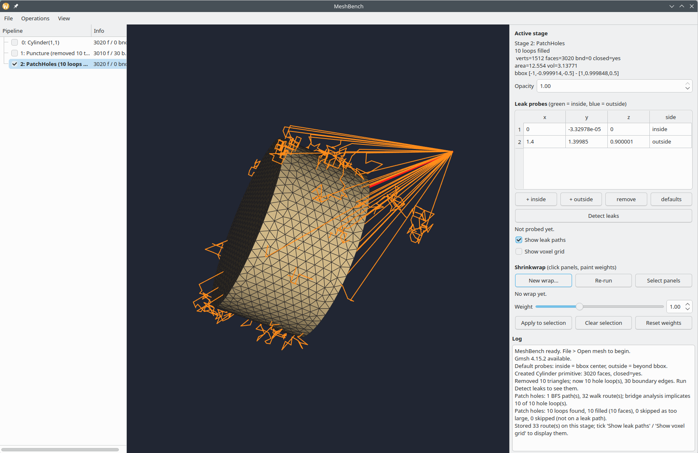

# MeshBench: GUI for Surface Mesh Operations



**AI Usage Disclaimer**: AI coding tools were used heavily in the development of MeshBench

MeshBench is a simple, easy-to-use GUI written in C++ for
3D surface mesh (i.e. STL) operations.

Supported **CGAL**-based operations include:
- Boolean operations
- Center geometry at center of volume
- CGAL alpha wrapping
- Slice with plane

MeshBench has additional functionality for **leak detection and leak patching**
which has been adapted from OpenFOAM's snappyHexMesh codebase.

Additional operations are provided by **gmsh** using the C++ gmsh API
- Create primitive shapes (box, sphere, ellipsoid, cylinder, cone, torus)
  meshed through the Gmsh OpenCASCADE kernel
- Remesh an STL with a target element size (the mesh is reclassified
  into patches and regenerated, so the size is actually honored; an
  empty result fails loudly instead of appending a 0-face stage)

**Shrinkwrap**: start from a high-resolution icosphere enclosing the active
mesh and snap it onto the body (closest-point attraction + Laplacian
smoothing). 
- Enable "Select panels" and click baseline triangles to select
them, then set a weight (0 = ignore region, 1 = normal pull, up to 3 =
strong pull) and Apply — the wrap re-snaps live. 
- The Shrinkwrap dialog also offers an Even spacing (0-1) knob: higher values relax vertices
tangentially toward even spacing without shrinking the wrap. 
- The wrap renders translucent cyan so the baseline shows through.

## Dependencies
- OS: OpenSUSE Tumbleweed
- Qt 6
- CGAL
- VTK
- CMake
- gmsh

```bash
sudo zypper install \
    gcc-c++ \
    cmake \
    ninja \
    cgal-devel \
    vtk-devel \
    vtk-qt \
    qt6-base-devel \
    qt6-widgets-devel \
    qt6-openglwidgets-devel \
    qt6-test-devel \
    gmsh-devel \
    libSM-devel \
    libICE-devel
```

## Building and running

```bash
rm -rf build
cmake -S . -B build -G Ninja -DCMAKE_BUILD_TYPE=Release
cmake --build build
./build/meshbench
```

Gmsh support is enabled by default and needs no extra flags
(`-DMESHBENCH_ENABLE_GMSH=OFF` disables it).

Running the GUI requires a display server (X11/Wayland).

## Testing

```bash
ctest --test-dir build --output-on-failure
```

